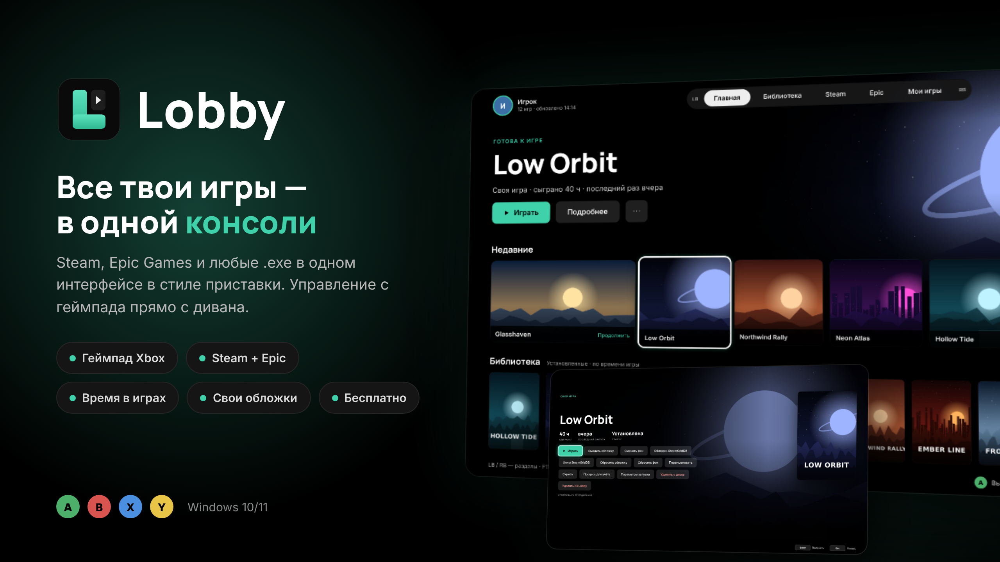
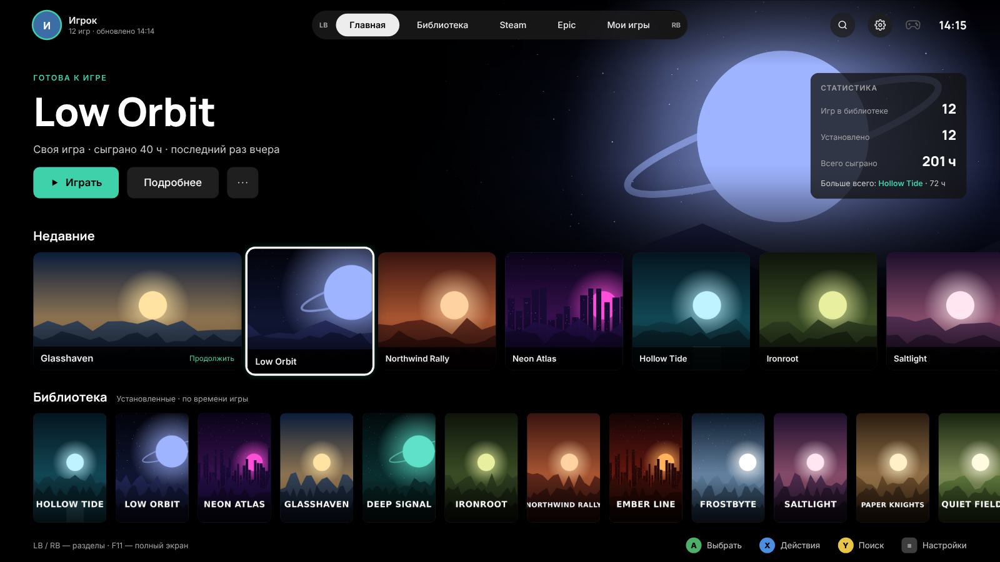
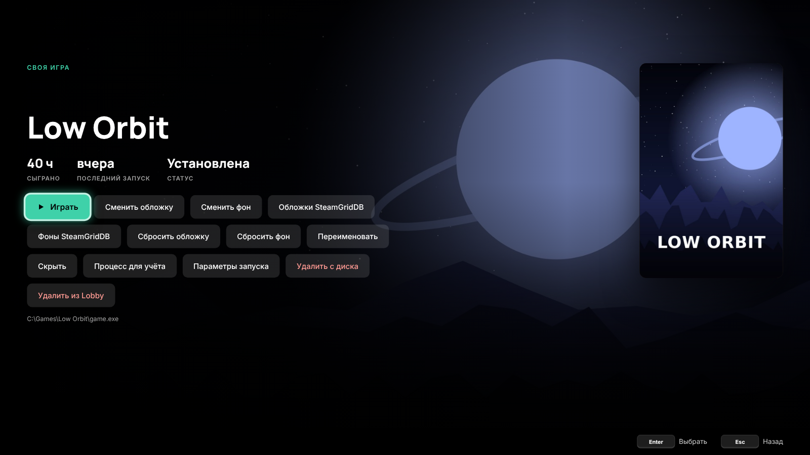
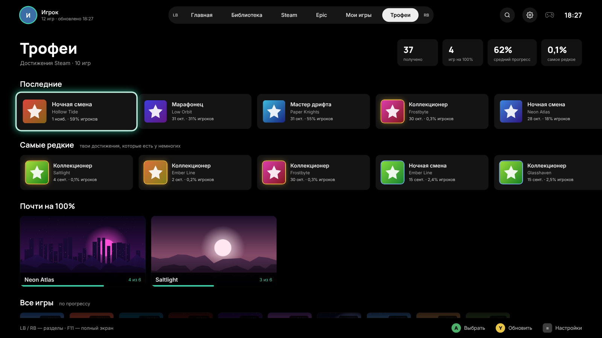
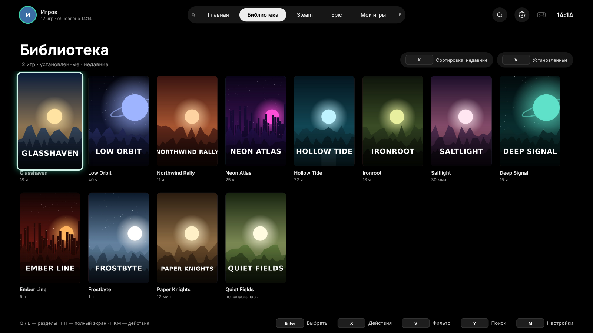
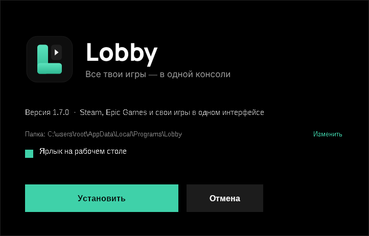

<p align="center"></p>

# Lobby

Консольный лаунчер игр для Windows. Steam, Epic Games и любые свои игры в одном интерфейсе в стиле игровой приставки, с управлением с геймпада прямо с дивана.

**[⬇ Скачать последнюю версию](https://github.com/Vikmat01/Lobby/releases/latest)** · Windows 10/11 x64

## Возможности

- **Steam.** Находит установленные игры и время в них. С ключом Steam Web API подтягивается вся библиотека, включая неустановленные игры.
- **Epic Games.** Установленные игры видны сразу. После входа в аккаунт появляются вся библиотека и время в играх.
- **Свои игры.** Можно добавить любой `.exe`, ярлык или `.url`, время в игре Lobby считает сам.
- **Установка и удаление** игр Steam и Epic прямо из интерфейса, с прогрессом загрузки.
- **Достижения Steam.** На странице игры видны прогресс, иконки, даты и редкость достижений. В разделе «Трофеи» собраны последние и самые редкие достижения и игры, близкие к 100%. Если что-то получено во время игры, после возвращения в Lobby появится карточка с новыми достижениями.
- **Обложки и фоны** берутся из Steam и Epic. Можно поставить свои картинки или выбрать из каталога [SteamGridDB](https://www.steamgriddb.com).
- **Геймпад Xbox:** вся навигация с контроллера. Кнопка Xbox (Guide) вызывает Lobby из любой программы.
- **Подсказки кнопок** сами переключаются между геймпадом и клавиатурой.
- **Game Bro.** Каждый день выдаёт три челленджа по установленным играм: сыграть в любимую, вернуться в забытую, впервые запустить новую или получить достижение. За челленджи начисляется опыт, уровень и полоска опыта видны рядом с профилем.
- **Награды за уровень.** С ростом уровня открываются рамки аватара (бронза, серебро, золото, неон), значки вместо аватара, титулы под ником, особые переливающиеся цвета «Закат», «Хром» и «Аврора», наборы звуков «Мягкие», «8-бит» и Sci-fi, живые фоны (туман, частицы, сияние), эффекты выбора «Блик» и «Искры» и анимация запуска игры. Все награды видны в карточке профиля, а при новом уровне Lobby показывает, что открылось.
- **Бонусы Game Bro:** с 10 уровня третья замена челленджа в день, с 20 четвёртый челлендж, с 25 недельный челлендж с двойным опытом. С 50 уровня можно уйти в престиж: уровень начинается заново, награды остаются, рядом с ником появляется звезда.
- **Автообновление.** Lobby сам находит новую версию в Releases, скачивает её и ставит без лишних окон.
- **Внешний вид:** 16 цветов акцента, размер интерфейса от 75 до 150%, звуки и анимации.

<p align="center">
   
   
</p>

## Установка

Скачай `Lobby-Setup-x.y.z.exe` из [Releases](https://github.com/Vikmat01/Lobby/releases) и запусти. Права администратора не нужны: программа ставится в `%LOCALAPPDATA%\Programs\Lobby`. Дальше Lobby обновляется сам.

<p align="center"></p>

Установщик не подписан, поэтому Windows SmartScreen покажет предупреждение. Нажми «Подробнее» → «Выполнить в любом случае».

## Управление

| Действие | Геймпад | Клавиатура |
|---|---|---|
| Навигация | Стик / крестовина | Стрелки |
| Выбрать / назад | A / B | Enter / Esc |
| Действия с игрой | X | X или ПКМ |
| Поиск | Y | Y |
| Разделы | LB / RB | Q / E |
| Настройки / фильтр | ≡ / ⧉ | M / V |
| Вызвать Lobby, на главную | Xbox | — |
| Полный экран, размер | — | F11, Ctrl + / Ctrl − |

Чтобы кнопка Xbox открывала Lobby, отключи её в Xbox Game Bar: Параметры → Игры → Xbox Game Bar → «Открывать с помощью этой кнопки на контроллере».

## Ключи и приватность

- **Достижения Steam** видны, только если в настройках приватности профиля Steam открыт раздел «Сведения об играх».
- **Ключ Steam Web API** бесплатный, его выдают на [steamcommunity.com/dev/apikey](https://steamcommunity.com/dev/apikey). Ключ SteamGridDB берётся в настройках профиля на [steamgriddb.com](https://www.steamgriddb.com/profile/preferences/api).
- **Где хранятся данные.** Ключи, библиотека и настройки лежат только у тебя на ПК, в `%APPDATA%\Lobby`. Токен входа в Epic зашифрован средствами Windows (DPAPI).
- **Вход в Epic** проходит на официальной странице Epic, Lobby не видит пароль. Используется тот же публичный клиент, что в Legendary, Heroic и Playnite. Это неофициальный способ, и Epic может его изменить.

## Сборка из исходников

Нужны Node.js 20+ и [NSIS](https://nsis.sourceforge.io) (`makensis` в PATH).

```bash
npm install
npm start        # запустить из исходников
npm run build    # dist/Lobby (портативная) и dist/Lobby-Setup-<версия>.exe
```

Сборка работает на Windows и на Linux. Версия берётся из `app/package.json`.

## Сторонние компоненты

- [Electron](https://www.electronjs.org): MIT
- [Koffi](https://koffi.dev): MIT, используется для кнопки Xbox через XInput
- Шрифты [Inter](https://rsms.me/inter/) и [Manrope](https://github.com/sharanda/manrope): SIL Open Font License 1.1

Steam, Epic Games и Xbox — товарные знаки их владельцев. Lobby не связан с Valve, Epic Games или Microsoft.

## Лицензия

[MIT](LICENSE)
